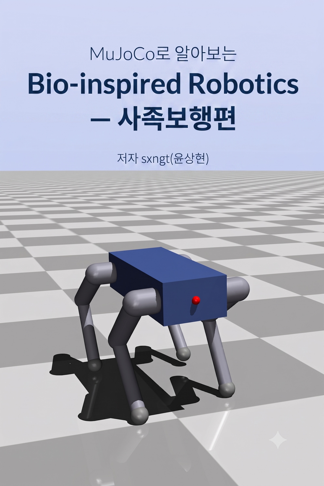
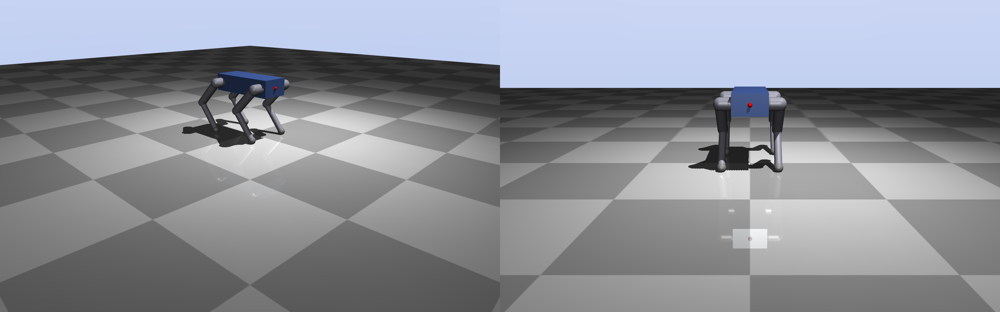
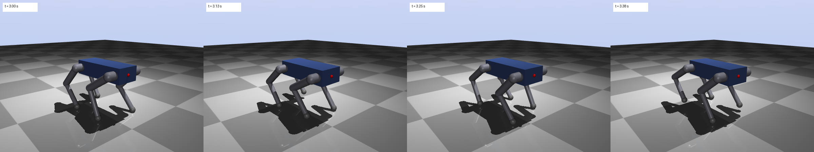
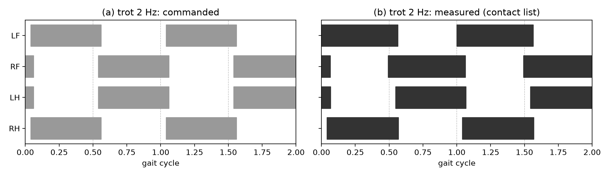
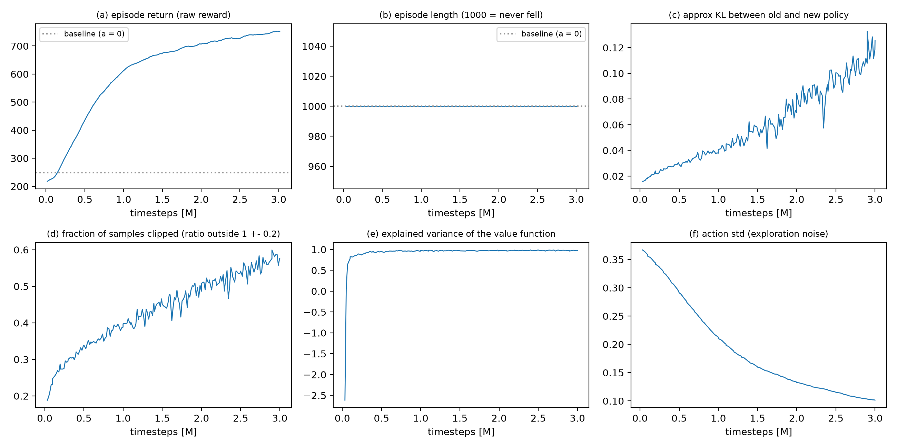
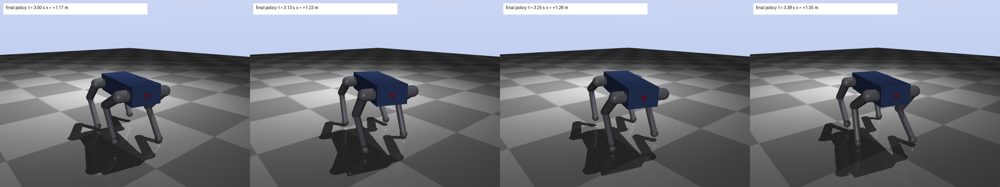
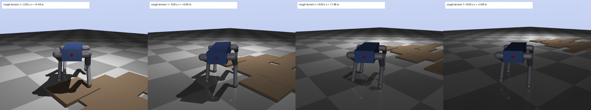

<p align="center">
  <a href="https://wikidocs.net/book/21135"></a>
</p>

<h1 align="center">MuJoCo로 알아보는 Bio-inspired Robotics: 사족보행편<br/>실습 코드</h1>

<p align="center">
  <a href="https://wikidocs.net/book/21135"><b>📖 전자책 읽기 (위키독스)</b></a> ·
  <a href="#빠른-시작">빠른 시작</a> ·
  <a href="#장별-실습">장별 실습</a> ·
  <a href="#문제가-생기면">문제 해결</a>
</p>

<p align="center">
  
  
  
  
  
</p>

이 저장소는 전자책 **《MuJoCo로 알아보는 Bio-inspired Robotics: 사족보행편》**(지은이 윤상현, sxngt)의 실습 코드입니다. 책에 실린 모든 코드와 그림은 이 저장소에서 실행해 검증한 것이며, 책의 각 절이 이 저장소의 스크립트 하나와 짝을 이룹니다. 책은 위키독스에서 읽을 수 있습니다.

> **책 바로가기: https://wikidocs.net/book/21135**

## 이 책과 저장소로 무엇을 하게 되나

로보틱스 보행에 입문하는 학생과 엔지니어를 위해, 한 마리의 사족보행 로봇을 **직접 만들고 → 걷게 하고 → 걸음을 측정하고 → 강화학습으로 보정하는** 전 과정을 시뮬레이터 안에서 끝까지 따라갑니다. GPU 없이 노트북 CPU만으로 모든 실습이 돌아갑니다.

| 만든다 | 걷게 한다 | 잰다 | 배운다 |
|---|---|---|---|
|  |  |  |  |
| 5장. MJCF로 12관절 사족 로봇을 설계하고 떨어뜨리고 밀어 검증 | 7장. 결합 위상 진동자(CPG)로 trot과 walk를 손으로 만들기 | 8장. 발 접촉을 기록해 duty factor·위상·Froude number로 동물과 비교 | 11장. Gymnasium 환경 + Stable Baselines3 PPO로 걸음을 보정(residual learning) |

<p align="center">
  <br/>
  <sub>12장의 최종 policy: 0.49 m/s로 곧게 걷고 50 N 밀기를 100% 버팁니다. 7장의 하드코딩 걸음(0.29 m/s, 60 N에 넘어짐)에서 여기까지가 이 책의 여정입니다.</sub>
</p>

이 책의 차별점은 **실패를 숨기지 않는 것**입니다. 하드코딩 걸음이 왜 딱딱한지 밀어서 넘어뜨려 보고(7.6절), 잘못 설계한 reward가 만드는 이상한 걸음을 일부러 모아 두었으며(12.3절 reward hacking 박물관), 경사에서 방향을 잃는 최종 policy의 한계까지 그대로 실었습니다(13.3절).

## 책의 구성

| Part | 장 | 내용 | 코드 |
|---|---|---|---|
| 서장 | 1장 | 걷는 법을 배우기 전에: AI 시대에 기본기를 말하다 | 없음 |
| 1 이해 | 2~3장 | Bio-Inspired Robotics라는 렌즈 / Gait의 언어(stance·swing, duty factor, 위상, support polygon, gait diagram) | 없음 |
| 2 도구 | 4~5장 | MuJoCo 첫걸음(MjModel·MjData, timestep, 접촉) / MJCF로 나의 사족보행 로봇 만들기 | `ch04`, `ch05` |
| 3 구현 | 6~8장 | 서기(PD 제어, gain 튜닝) / 첫 보행(CPG, trot, walk, open-loop의 한계) / gait 분석 실습 | `ch06`, `ch07`, `ch08` |
| 4 학습 | 9~12장 | 강화학습이라는 보정 도구 / Gymnasium 환경 / SB3 PPO 학습 / reward 설계와 curriculum | `ch09`, `ch10`, `ch11`, `ch12` |
| 5 확장 | 13장 | 거친 지형과 외란, MJX 병렬화, sim-to-real | `ch13` |
| 부록 | A~D | 트러블슈팅 25항목 / MJCF 레퍼런스 / 용어집 / 논문·오픈소스 로드맵 | |

## 빠른 시작

필요한 것은 [uv](https://docs.astral.sh/uv/) 하나입니다. Python 3.12와 가상환경은 uv가 만들어 줍니다. macOS, Linux, Windows 모두 됩니다.

```bash
git clone https://github.com/sxngt/mujoco-bio-inspired-robotics-kr.git
cd mujoco-bio-inspired-robotics-kr

uv sync                 # 4~8장: mujoco, numpy, matplotlib, gymnasium
uv sync --extra rl      # 10~12장: + stable-baselines3, torch, tensorboard
uv sync --extra mjx     # 13장: + mujoco-mjx, jax (선택)

uv run python ch04-mujoco-first-steps/01_hello_mujoco.py   # 첫 실습: 상자를 떨어뜨린다
uv run python ch07-first-gait/03_trot.py                   # 로봇이 처음 걷는다 (그림을 out/에 저장)
```

| 항목 | 버전 | 비고 |
|---|---|---|
| Python | 3.12 | `.python-version`으로 고정 |
| MuJoCo | 3.12.0 | `mujoco` 파이썬 패키지(viewer 포함) |
| Gymnasium | ≥ 1.3 | 10장부터 |
| Stable Baselines3 / PyTorch | ≥ 2.9 / ≥ 2.8 | `rl` extra, 11장부터 |
| MuJoCo MJX + JAX | 3.12.0 / ≥ 0.11 | `mjx` extra, 13장만 |

### 실습 장면을 직접 보기: `--view`

모든 스크립트는 기본으로 그림 파일을 `out/`에 저장하고 끝납니다. 책의 그림과 같은 장면을 **viewer 창에서 실시간으로** 보려면 `--view`를 붙입니다. 실제 물리는 생각보다 빠르게 보이므로(1 m 낙하가 0.45초) 공부할 때는 `--speed 0.5`(절반 속도)를 권합니다. 배속을 줄여도 물리는 바뀌지 않습니다.

```bash
uv run python   ch07-first-gait/03_trot.py --view --speed 0.5    # Linux, Windows
uv run mjpython ch07-first-gait/03_trot.py --view --speed 0.5    # macOS는 창을 띄울 때만 mjpython
```

창 안에서 마우스 드래그로 시점을 돌리고, Ctrl(맥은 Cmd)+드래그로 로봇을 잡아 밀 수 있습니다.

### 미리 학습된 policy가 들어 있습니다

11~13장의 학습(3M 스텝 약 8분, 12장 curriculum 총 9M 스텝 약 20분, CPU 기준)을 건너뛰고 싶다면 각 장 `out/`에 있는 학습 결과를 그대로 쓰면 됩니다. 뒤 장이 앞 장의 결과를 읽도록 되어 있습니다.

| 파일 | 내용 |
|---|---|
| `ch11-sb3-training/out/ppo_first.zip` + `_vecnormalize.pkl` | 첫 PPO policy (0.84 m/s, 하지만 yaw 40° 방향 이탈) |
| `ch12-reward-shaping/out/R1_*.zip` ~ `R4_full.zip` | reward 항을 하나씩 더한 통제 실험 |
| `ch12-reward-shaping/out/H1_*.zip` ~ `H4_*.zip` | reward hacking 박물관(일부러 잘못 만든 reward) |
| `ch12-reward-shaping/out/C_curriculum_6M.zip` | **최종 policy** (밀기 curriculum 20→60 N) |
| `ch13-wider-world/out/A_*.zip`, `B_*.zip` | 선속도 없는 관측, 잔차 전용, 생성기 개방 실험 |
| `ch08-gait-analysis/out/logs.npz` | 8장 접촉 로그(02~05가 읽음) |

`*.zip`은 SB3 모델, 짝이 되는 `*_vecnormalize.pkl`은 관측·reward 정규화 통계입니다. 둘을 항상 함께 불러옵니다(`ch11-sb3-training/common.py`의 `load_trained`).

## 장별 실습

각 장 폴더의 `README.md`에 스크립트와 책의 절이 대응표로 정리되어 있습니다. 스크립트 번호는 본문에 등장하는 순서입니다.

| 폴더 | 장 | 스크립트 | 이 장에서 생기는 공용 코드 |
|---|---|---|---|
| [`ch04-mujoco-first-steps`](ch04-mujoco-first-steps) | 4장 MuJoCo 첫걸음 | 01 낙하 · 02 viewer · 03 MjModel/MjData · 04 timestep과 접촉 · 05 파이썬 제어 · 06 오프스크린 렌더링 | |
| [`ch05-mjcf-modeling`](ch05-mjcf-modeling) | 5장 MJCF 모델링 | 01 몸통 · 02 다리 하나 · 03 로봇 검사 · 04 센서 · 05 검증(낙하·밀기) | `models/quadruped.xml`, `quadbook/robot.py` |
| [`ch06-standing-control`](ch06-standing-control) | 6장 서기 | 01 토크 vs 위치 제어 · 02 PD 직관 · 03 gain 튜닝 · 04 외란 버티기 | `quadbook/control.py` |
| [`ch07-first-gait`](ch07-first-gait) | 7장 첫 보행 | 01 발 궤적 · 02 CPG · 03 trot · 04 walk · 05 매개변수 실험 · 06 open-loop의 한계 | `quadbook/cpg.py`, `quadbook/sim.py` |
| [`ch08-gait-analysis`](ch08-gait-analysis) | 8장 gait 분석 | 01 접촉 로깅 · 02 gait diagram · 03 지표 · 04 동물과 비교 · 05 넘어짐 해부 | `quadbook/analysis.py` |
| [`ch09-rl-refinement`](ch09-rl-refinement) | 9장 강화학습 | 01 학습 전 무작위 policy는 얼마나 걷는가(보조 실험) | |
| [`ch10-gym-environment`](ch10-gym-environment) | 10장 환경 | 01 인터페이스 · 02 observation · 03 action · 04 reward · 05 종료와 리셋 | `quadbook/env.py` (`QuadBook/Quadruped-v0`) |
| [`ch11-sb3-training`](ch11-sb3-training) | 11장 PPO 학습 | 01 설정 · 02 VecEnv/VecNormalize · 03 첫 학습 · 04 학습 곡선 · 05 학습 전후 비교 | `common.py` |
| [`ch12-reward-shaping`](ch12-reward-shaping) | 12장 reward 설계 | 00 전체 학습 · 01 통제 실험 · 02 항 분석 · 03 reward hacking · 04 curriculum · 05 최종 분석 | `train_lib.py` |
| [`ch13-wider-world`](ch13-wider-world) | 13장 더 넓은 세계 | 00 학습 · 01 강건성 · 02 MJX 벤치마크 · 03 sim-to-real 간극 · 04 생성기 개방 · 05 경사 해부 | `train_lib.py`, `models/quadruped_rough.xml` 등 |

<p align="center">
  <br/>
  <sub>13장. 평지에서만 배운 policy를 거친 지형·경사·마찰·짐 위에 놓아 어디까지 버티는지 봅니다.</sub>
</p>

## 폴더 구조

```
.
├── pyproject.toml / uv.lock     # 의존성과 버전 고정
├── quadbook/                    # 장 사이에 공유하는 패키지 (from quadbook import ...)
│   ├── robot.py                 # 로봇 상수, 서기 자세, 접촉 도우미 (5장)
│   ├── control.py               # PD 제어, 중력 보상, 임계 감쇠 (6장)
│   ├── cpg.py, sim.py           # FK/IK, 발 궤적, 결합 진동자, 걸음 생성기, 공용 루프 (7장)
│   ├── analysis.py, gait.py     # gait 지표, support margin, Froude, gait diagram (3·8장)
│   ├── env.py                   # Gymnasium 환경 QuadrupedEnv (10장, 12·13장이 확장)
│   └── render.py                # 스냅샷, 자세 렌더링, 추적 카메라, --view 재생
├── models/                      # MJCF 로봇 (quadruped.xml)과 13장의 지형·경사 변형
├── ch04-mujoco-first-steps/ … ch13-wider-world/
│   ├── NN_name.py               # 본문 순서대로 번호 붙은 실습 스크립트 (모두 --view 지원)
│   ├── README.md                # 스크립트 ↔ 책의 절 대응표
│   └── out/                     # 실행 결과. 뒤 장이 읽는 정책·지표·데이터가 미리 들어 있음
├── fix_mjpython.sh              # macOS mjpython 오류 한 번에 고치기
└── docs/images/                 # 이 README의 그림
```

- 1~3장은 코드가 없는 장이라 폴더가 없습니다. 9장 폴더에는 보조 실험 하나만 있습니다.
- 장 폴더끼리는 직접 import하지 않습니다. 공유 코드는 모두 `quadbook/`에 있습니다.
- 단위는 m, kg, s, rad. 좌표는 앞이 +x, 왼쪽이 +y, 위가 +z. 다리는 LF, RF, LH, RH(왼앞, 오른앞, 왼뒤, 오른뒤).

## 문제가 생기면

- **macOS에서 `uv run mjpython ...`이 `Library not loaded: @rpath/libpython3.12.dylib`로 실패**: uv가 설치한 Python의 libpython을 mjpython이 못 찾는 것입니다. `./fix_mjpython.sh`를 한 번 실행합니다(`.venv`를 다시 만들었다면 다시 실행).
- **`SubprocVecEnv`가 표준입력(REPL)에서 안 됨**: 스크립트 파일로 실행해야 합니다(spawn 방식).
- **학습 결과가 책과 소수점까지 같지 않음**: 정상입니다. 물리는 결정론적이지만 학습은 seed와 하드웨어에 따라 조금 다릅니다. 경향이 같으면 됩니다.
- **서로 다른 설정의 결과가 소수점까지 똑같음**: 설정이 적용되지 않은 것입니다(VecEnv에서는 `env_method`로 환경의 메서드를 불러야 합니다).
- 그 밖의 25가지 함정(접촉이 안 생김, 마찰을 바꿨는데 변화 없음, `mj_setConst` 뒤 자세가 초기화됨, 야간 모드…)은 책의 **부록 A 트러블슈팅**에 증상·원인·해결로 정리되어 있습니다.

버그나 질문은 이 저장소의 [Issues](https://github.com/sxngt/mujoco-bio-inspired-robotics-kr/issues)에 남겨 주세요. 책 본문의 오류도 환영합니다.

## 지은이

**윤상현(sxngt)**. 예이린사회적협동조합 CTO, AI 로보틱스 석사과정 연구자. 방위산업과 드론 연구를 거쳐 사람을 다시 움직이게 하는 기술(차세대 의수)을 목표로 locomotion을 연구하고 있습니다. 이 책과 코드는 그 첫 관문인 gait와 Bio-Inspired Robotics를 먼저 헤매 본 사람이 남기는 안전한 출발점입니다.

## 저작권

© 2026 윤상현(sxngt). 이 저장소의 코드는 학습 목적으로 자유롭게 실행하고 수정할 수 있습니다. 책의 본문과 그림의 저작권은 저자에게 있으며, 책은 [위키독스](https://wikidocs.net/book/21135)에서 읽을 수 있습니다. MuJoCo, Gymnasium, Stable Baselines3, PyTorch, JAX는 각 저작권자의 프로젝트입니다.
